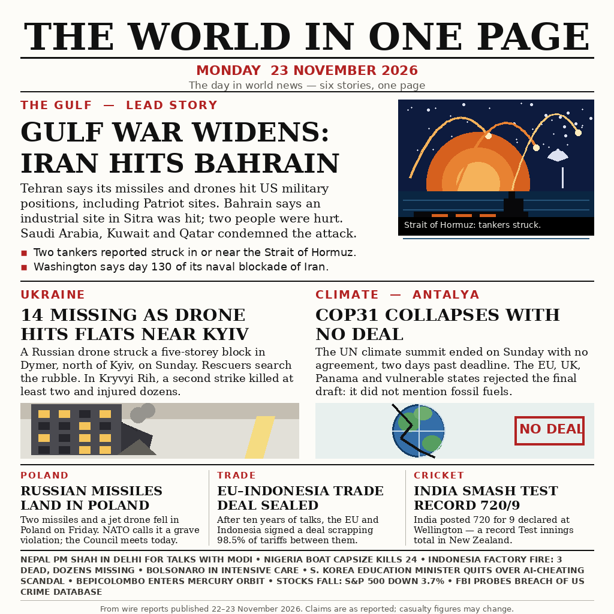

# The World in One Page — Monday 23 November 2026

[](https://make.fun/c/news-image-20261123)
[](https://make.fun/c/news-image-20261123)
[](https://make.fun/c/news-image-20261123)

A one-page newspaper summing up the world's news of **Monday 23 November
2026** in a single 1024×1024 image — entry for the
[news-image-20261123](https://make.fun/c/news-image-20261123) bounty on
make.fun.



## What's on the page

- **Lead — The Gulf:** Iran says its missiles and drones hit US military
  positions, including Patriot sites; Bahrain says an industrial site in
  Sitra was hit and two people were hurt. Saudi Arabia, Kuwait and Qatar
  condemned the attack. Two tankers reported struck in or near the Strait
  of Hormuz; Washington says day 130 of its naval blockade of Iran.
- **Ukraine:** 14 missing after a Russian drone hit a five-storey block in
  Dymer, north of Kyiv; a second strike in Kryvyi Rih killed at least two.
- **Climate — Antalya:** COP31 collapsed with no deal, two days past
  deadline; the EU, UK, Panama and vulnerable states rejected a final
  draft that did not mention fossil fuels.
- **Poland:** Russian missiles landed in Poland; NATO calls it a grave
  violation and the Council meets today.
- **Trade:** the EU–Indonesia deal sealed after ten years of talks,
  scrapping 98.5% of tariffs.
- **Cricket:** India smashed a Test record with 720/9 declared at
  Wellington.
- Plus a ticker: Nepal's PM in Delhi, the Nigeria boat capsize, the
  Indonesia factory fire, Bolsonaro in intensive care, South Korea's
  education minister quitting, BepiColombo entering Mercury orbit, stocks
  falling, and the FBI probing a breach of the US crime database.

Claims are reported as reported; casualty figures may change. Sources: wire
reports published 22–23 November 2026.

## How it works

The page is rendered from a deterministic drawing script (Pillow, system
DejaVu fonts) into `entry.png`. `main.ts` (Node 22, standard library only)
copies that image to `$MAKEFUN_OUTPUT_DIR/entry.png`, so two runs produce
byte-identical output:

```sh
mkdir -p out && MAKEFUN_OUTPUT_DIR=out node main.ts
```

## License

MIT — see [LICENSE](LICENSE).
